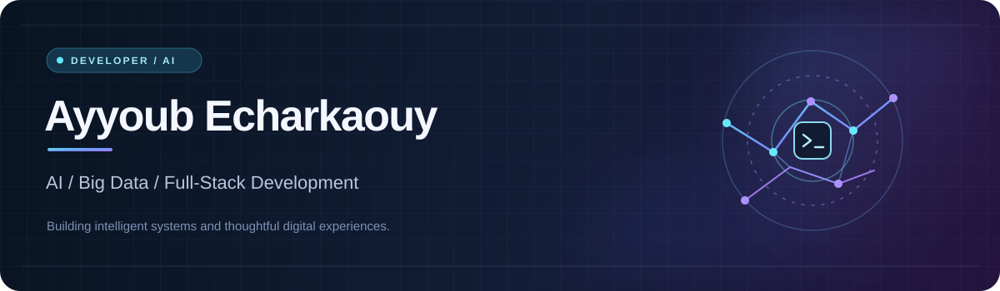

  

   

  **Exploring artificial intelligence, data engineering, and software development — one project at a time.**

  

## 👋 About Me

I'm **Ayyoub Echarkaouy**, a developer building projects across **AI / machine learning**, **Big Data**, **modern web applications**, and **Android experiences**.

My work includes real-time IoT dashboards, Arabic-language NLP experiments, offline music playback, and computer-vision research.

## ⚙️ Tech Stack

**Languages**

**AI & Data**

**Web & Infrastructure**

## 🚀 Featured Projects

| Project | Description | Technologies |
|:--|:--|:--|
| 🏙️ **[Smart City](https://github.com/ayyoubecharkaouy/smart-city)** | Real-time smart-city platform for environmental, traffic, and water data, from IoT-style simulation to streaming analytics and dashboards. | Next.js · Kafka · PySpark · Node-RED · Docker |
| 🧠 **[Ayyech Model](https://github.com/ayyoubecharkaouy/ayyech-model)** | Experimental Arabic NLP pipeline covering text preparation, tokenization, and Transformer training workflows. | Python · PyTorch · NLP |
| 🎵 **[AyyMusic](https://github.com/ayyoubecharkaouy/ayyoub-music)** | Local-first Android music player with an offline library, polished playback interface, playlists, and customizable metadata. | JavaScript · Tailwind CSS · Capacitor |
| 📷 **[AyyPhoto](https://github.com/ayyoubecharkaouy/ayyoub-photo)** | **Work in progress:** image-denoising experiments using PyTorch notebooks, with a future Android app planned. | Python · PyTorch · Computer Vision |

## 🎯 What I'm Exploring

- **Intelligent applications:** practical uses of AI and NLP.
- **Streaming data systems:** connecting data pipelines with responsive dashboards.
- **Product experience:** creating clear, useful interfaces for mobile and web.

---

  Made with curiosity and code • <a href="https://github.com/ayyoubecharkaouy?tab=repositories">Explore all repositories</a>

